Gregorys Morel Duluc - Matricula 2025-0035 - Practica A1: AAA con RADIUS

Repositorio GitHub: https://github.com/gregomorel79-dev/A1-AAA-RADIUS-2025-0035
Video YouTube: https://youtu.be/BwiUiJGE4lA
 
**Estudiante:** Gregorys Morel Duluc · **Matrícula:** 2025-0035 · **Materia:** Seguridad de Redes · **ITLA**

---

## 1. Propósito del laboratorio

Implementar **AAA (Autenticación, Autorización y Registro/Accounting)** en equipos Cisco usando un servidor **RADIUS (NPS de Windows Server)** integrado con **Active Directory**, de forma que:

- Los administradores se autentiquen con sus cuentas del dominio, **no** con contraseñas locales compartidas.
- Cada usuario reciba un **nivel de privilegio distinto (0, 5 o 10)** según el **grupo de AD** al que pertenece (control de acceso por rol / mínimo privilegio).
- Todo intento de acceso quede **registrado** (logs locales y accounting hacia el servidor RADIUS).
- Si el servidor RADIUS no está disponible, el administrador pueda entrar con un **usuario local de respaldo**, sin quedarse fuera del equipo.
- La gestión remota se haga por **SSH v2** (nunca Telnet).

## 2. Topología y direccionamiento (basado en la matrícula)

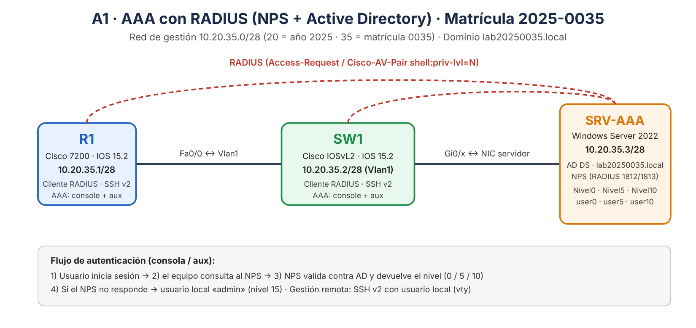

El direccionamiento se deriva de la matrícula **2025-0035**: red **10.20.35.0/28** → `20` = año de la matrícula (2025) y `35` = número de la matrícula (0035). El dominio es `lab20250035.local`.

| Equipo | Rol | Interfaz | IP | Máscara |
|---|---|---|---|---|
| R1 | Router Cisco 7200 (IOS 15.2) · cliente RADIUS | Fa0/0 | 10.20.35.1 | /28 (255.255.255.240) |
| SW1 | Switch Cisco IOSvL2 · cliente RADIUS | Vlan1 | 10.20.35.2 | /28 (gateway 10.20.35.1) |
| SRV-AAA | Windows Server 2022 · AD DS + NPS | NIC | 10.20.35.3 | /28 (gateway 10.20.35.1) |

Entorno: GNS3 2.2 + GNS3 VM (VirtualBox); el servidor es una VM de VirtualBox conectada a la topología mediante un nodo *Cloud*.

## 3. Cumplimiento de los requisitos

| # | Requisito del enunciado | Cómo se cumple | Evidencia |
|---|---|---|---|
| 1 | 1 router + 1 switch Cisco con seguridad en todos los niveles de autenticación/autorización | AAA nuevo-modelo, listas de métodos, autorización exec, privilegios por RADIUS | [R1](configs/R1-running-config.txt) · [SW1](configs/SW1-running-config.txt) |
| 2 | Equipos como **clientes RADIUS** | `radius server NPS` (10.20.35.3, puertos 1812/1813) + clientes R1 y SW1 registrados en NPS | [Imagen 12](img/12-nps-clientes-radius.png), [Imagen 13](img/13-r1-aaa-servers-y-logs.png) |
| 3 | **Usuario local** | `username admin privilege 15 secret ...` (respaldo si RADIUS no responde y acceso SSH) | Imágenes 11 y 13 |
| 4 | **AAA solo en consola y aux** | Listas `CON-AUTH` / `CON-AUTHZ` / `CON-ACCT` aplicadas únicamente a `line con 0` y `line aux 0`; las vty usan solo local (`VTY-LOCAL`) | running-configs |
| 5 | **Logging** de autenticación, autorización y RADIUS | `login on-success/on-failure log`, `logging buffered`, accounting exec y system hacia RADIUS | [Imagen 13](img/13-r1-aaa-servers-y-logs.png) |
| 6 | Servicio **SSH** | `ip domain-name`, llave RSA 2048, `ip ssh version 2`, `transport input ssh` | [Imagen 11](img/11-ssh-servidor-a-r1-priv15.png), [Imagen 09](img/09-sw1-ssh-v2-y-test-radius.png) |
| 7 | **Windows Server con Active Directory**: 1 grupo nivel 0, 1 nivel 5, 1 nivel 10 | Grupos `Nivel0`, `Nivel5`, `Nivel10` con `user0`, `user5`, `user10` | [Imagen 02](img/02-ad-grupos-y-pings.png) |
| 8 | **NPS** | 3 directivas de red (una por grupo) que devuelven `Cisco-AV-Pair = shell:priv-lvl=N` | Imágenes 03 a 07 |

## 4. Cómo funciona

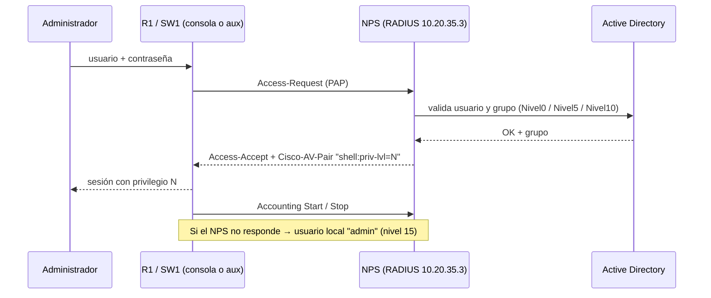

### Usuarios, grupos y niveles

| Usuario AD | Grupo AD | Directiva NPS | Privilegio en Cisco |
|---|---|---|---|
| user0 | Nivel0 | Nivel0 | 0 |
| user5 | Nivel5 | Nivel5 | 5 |
| user10 | Nivel10 | Nivel10 | 10 |
| admin (local) | — | — | 15 (respaldo / SSH) |

> Credenciales de laboratorio: usuarios de dominio con contraseña `Redes2025Lab`; secreto RADIUS `Radius2025Lab`; usuario local `admin` / `Local2025Lab`. Son valores de práctica en una red aislada.

## 5. Implementación paso a paso

1. **Red base** — IPs de R1, SW1 y el servidor ([R1](scripts/R1-config.txt), [SW1](scripts/SW1-config.txt), [servidor](scripts/servidor-01-red-y-AD.ps1)).
2. **Active Directory** — bosque `lab20250035.local`, grupos y usuarios con PowerShell ([script](scripts/servidor-01-red-y-AD.ps1)).
3. **NPS** — rol NPAS, registro en AD, clientes R1/SW1 y 3 directivas de red ([script](scripts/servidor-02-NPS.ps1)).
4. **AAA en R1 y SW1** — RADIUS, listas de métodos, SSH v2, logging y accounting ([R1](scripts/R1-config.txt), [SW1](scripts/SW1-config.txt)).
5. **Pruebas** — `test aaa`, inicio de sesión real y SSH.

### 5.1 Active Directory y conectividad
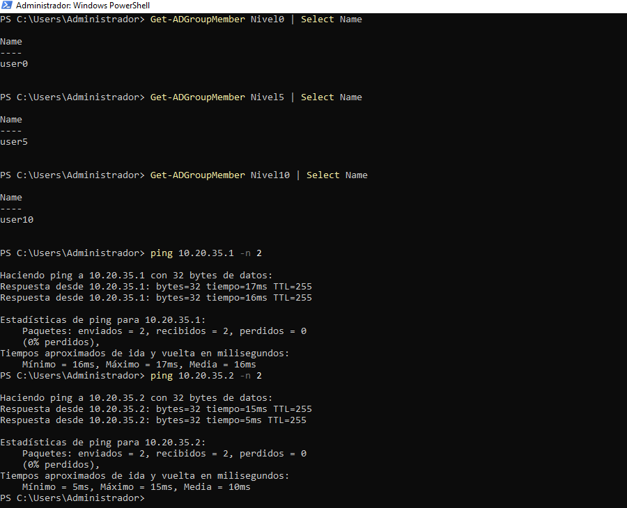

### 5.2 Directivas de red en NPS
Directiva **Nivel5** habilitada y directivas por defecto deshabilitadas:

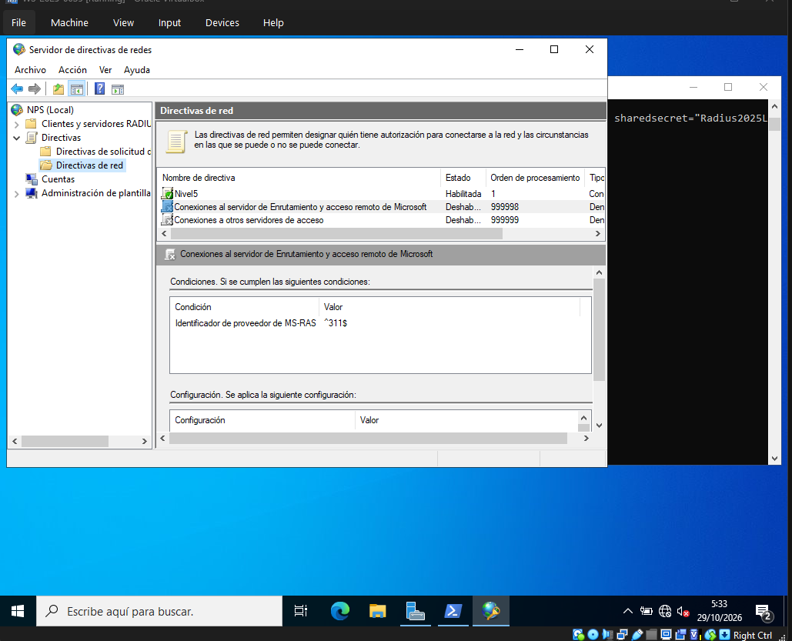

Atributo `Cisco-AV-Pair = shell:priv-lvl=5` (el nivel que recibe el usuario):

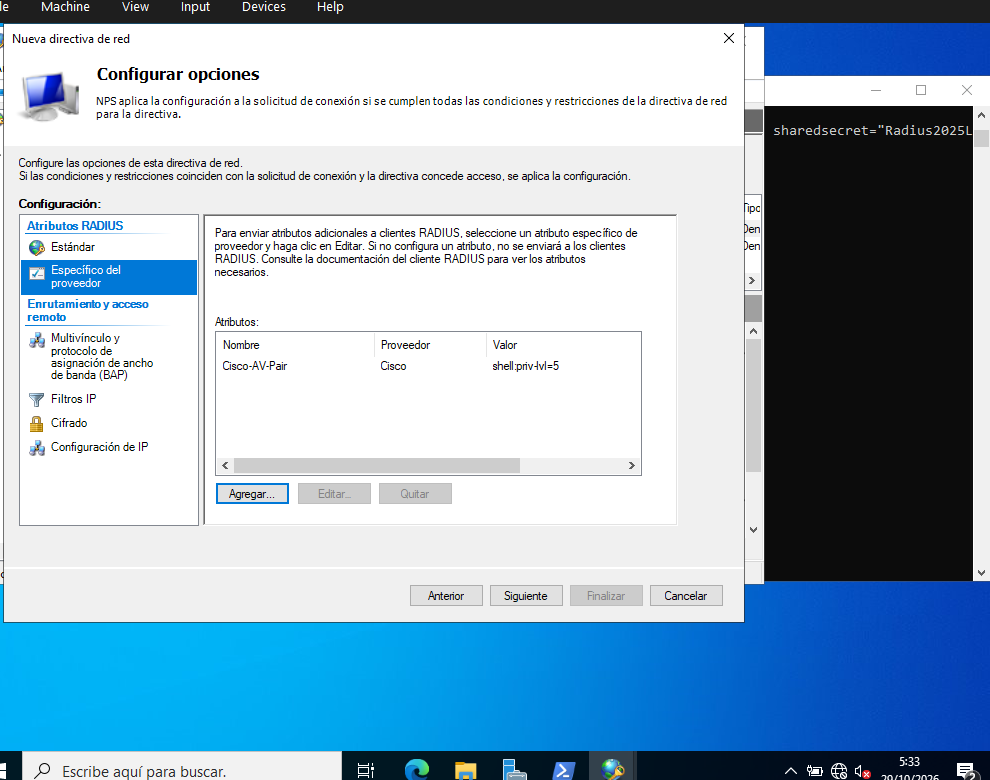

Nivel10 (`shell:priv-lvl=10`) y Nivel0 (`shell:priv-lvl=0`):

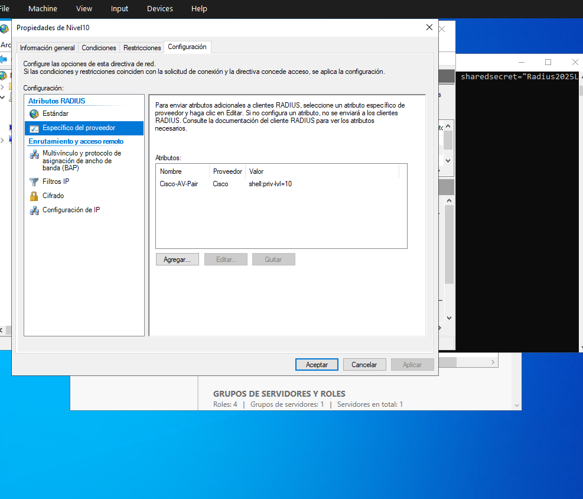
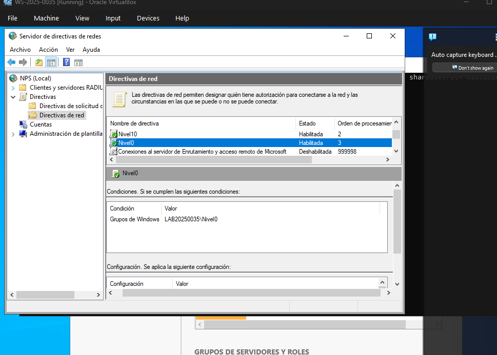
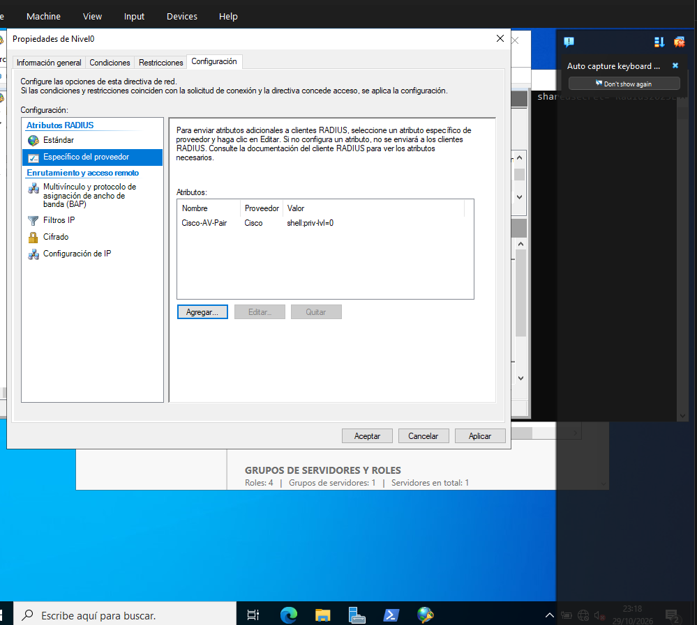

Clientes RADIUS registrados (R1 y SW1):

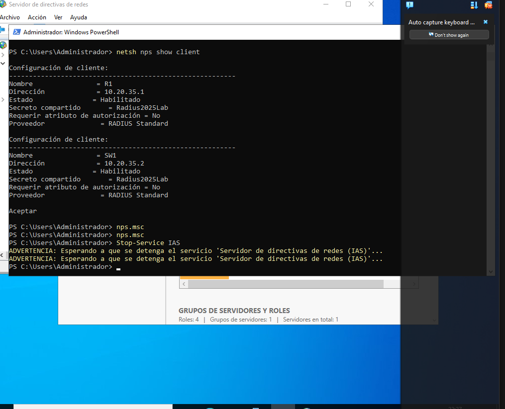

## 6. Pruebas y resultados

### 6.1 `test aaa` en R1: los tres niveles
Cada usuario devuelve el privilegio de su grupo (`priv-lvl 5`, `0` y `10`):

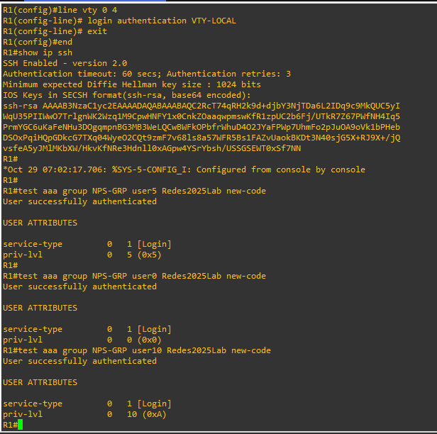

### 6.2 SW1: SSH v2 y autenticación RADIUS
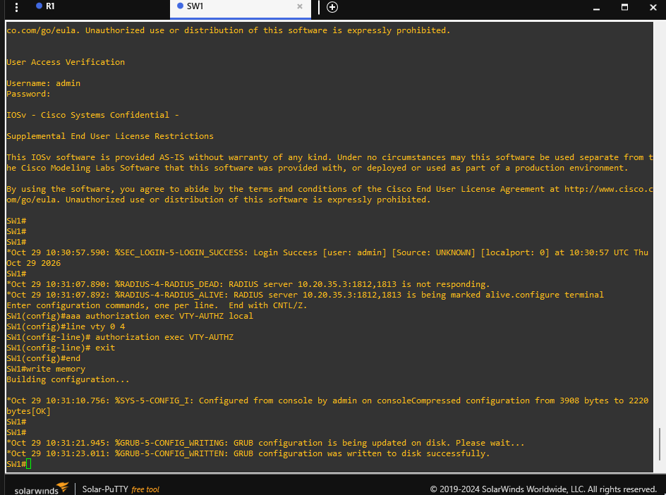

Inicio de sesión real en la consola de SW1 con `user5` → `Current privilege level is 5`:

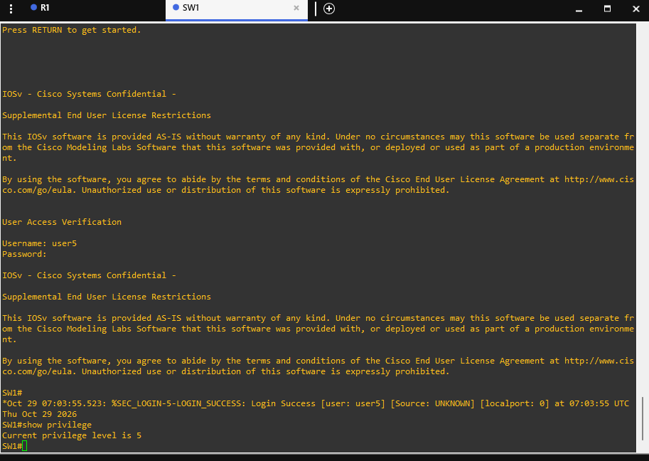

### 6.3 SSH desde el servidor hacia R1
Acceso SSH con el usuario local (vty usa solo local) → privilegio 15:

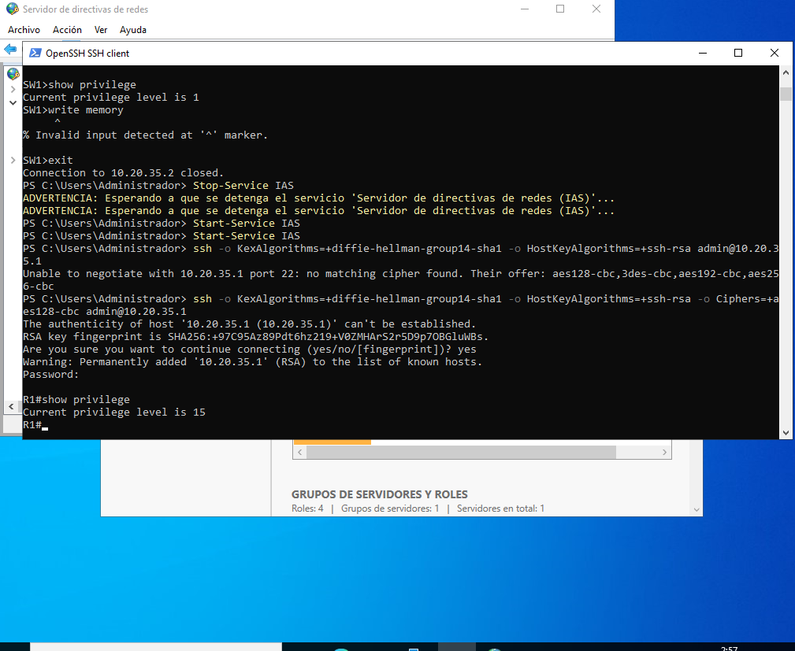

### 6.4 Servidor RADIUS y logs en R1
`show aaa servers` (RADIUS activo, solicitudes de autenticación y accounting) y `show logging` con los eventos de login:

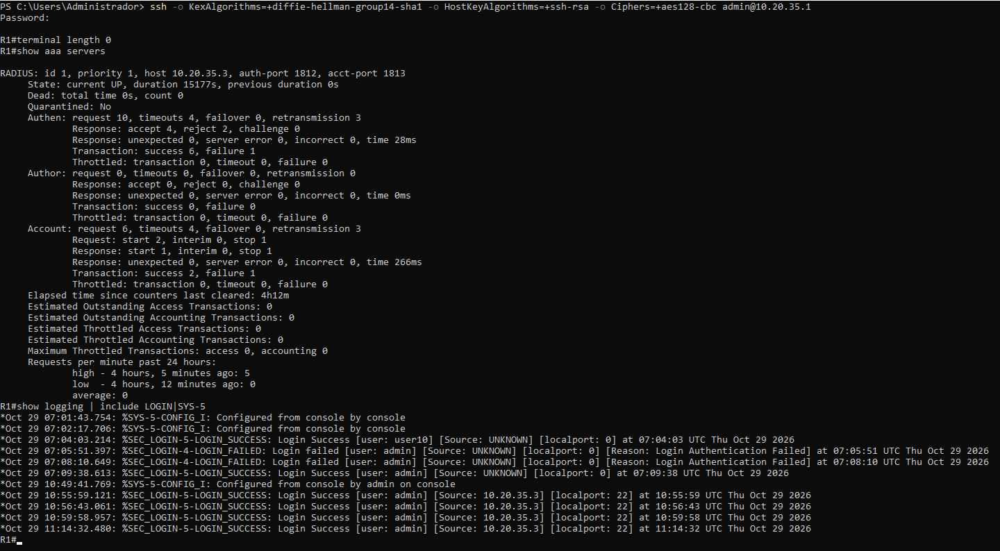

Lectura de los logs:
- `LOGIN_SUCCESS [user: user10]` en consola → autenticación RADIUS correcta (privilegio 10).
- `LOGIN_FAILED [user: admin]` mientras el NPS estaba activo → el usuario local **no** entra en consola cuando RADIUS responde (solo es respaldo).
- `LOGIN_SUCCESS [user: admin]` en consola tras detener el servicio NPS → **respaldo local** funcionando.
- `LOGIN_SUCCESS [user: admin] [Source: 10.20.35.3] [localport: 22]` → accesos por **SSH** desde el servidor.

## 7. Estructura del repositorio

```
├── README.md
├── configs/
│   ├── R1-running-config.txt
│   └── SW1-running-config.txt
├── scripts/
│   ├── R1-config.txt
│   ├── SW1-config.txt
│   ├── servidor-01-red-y-AD.ps1
│   └── servidor-02-NPS.ps1
└── img/                      (diagrama y capturas)
```

## 8. Observaciones

- En la consola de R1 y SW1 el cliente se autentica contra RADIUS con **PAP**, que es lo que acepta el cliente RADIUS de Cisco con el NPS; por eso las directivas de red solo permiten PAP/SPAP.
- Las líneas **vty** se dejaron con autenticación **local** y `transport input ssh`, porque el enunciado limita AAA a consola y aux.
- Para guardar la configuración con `write memory` hace falta nivel 15; los usuarios RADIUS de nivel 0, 5 y 10 no pueden hacerlo (comportamiento esperado del control por niveles).
